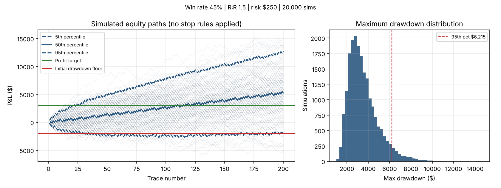
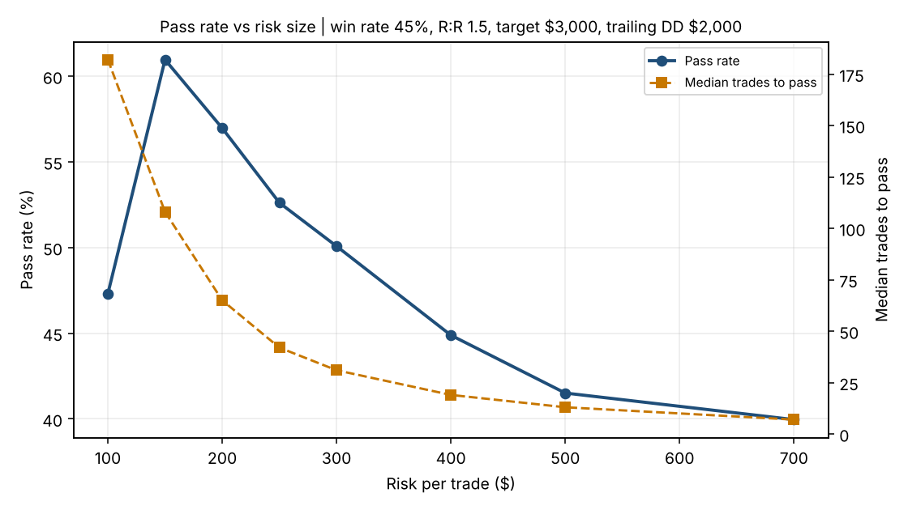

# Monte Carlo Risk Simulator

A small Python tool I use to stress-test trading strategies before putting money on them.

A backtest gives one path. The market will give a different one. This simulates thousands of possible trade sequences from three inputs (win rate, reward:risk and risk per trade) and shows the range of outcomes: how deep drawdowns get, how long losing streaks run, and how often an attempt passes or fails a prop-firm style evaluation.

## What it reports

- Expectancy per trade (in R), break-even win rate and the Kelly fraction
- Final P&L, maximum drawdown and longest losing streak, as percentiles
- Pass, fail and unresolved rates under evaluation rules: profit target, trailing drawdown (optionally locked at the starting balance) and a daily loss limit
- Fixed-dollar or fixed-fraction (compounding) position sizing, with per-trade costs

## Quick start

```bash
pip install numpy matplotlib

python mc_risk.py --win-rate 0.45 --rr 1.5 --risk 250 \
    --start 50000 --target 3000 --trailing-dd 2000 --daily-loss 1000 \
    --trades 200 --trades-per-day 2 --cost 5 --sims 20000 \
    --plot examples/eval_45pct_1.5rr.png
```

```
Strategy
  Win rate 45%, reward:risk 1.5, risk $250 per trade
  Expectancy:          +0.125 R per trade (before costs)
  Break-even win rate: 40.0%
  Full Kelly fraction: 8.3% of equity

Over 200 trades, 20,000 simulations
  Final P&L      median $     5,250   5th pct $    -1,625   95th pct $    12,750
  Max drawdown   median $     3,235   95th pct $     6,215   99th pct $     8,055
  Losing streak  median    8   95th pct   12   worst   23

Evaluation rules: target +$3,000, trailing DD $2,000, daily loss $1,000 (2 trades/day)
  Pass 52.9%   Fail 47.0%   Unresolved after 200 trades 0.1%
  Median trades to pass: 42
```



## What I found: bigger risk does not mean faster passing

The strategy above has a real edge (+0.125R per trade). But at $250 risk, the median max drawdown over 200 trades ($3,235) is bigger than the $2,000 trailing limit. So the rules, not the strategy, decide most outcomes.

`risk_sweep.py` runs the same strategy at different sizes against a $3,000 target and $2,000 trailing drawdown, with $5 costs and up to 300 trades:

```bash
python risk_sweep.py --win-rate 0.45 --rr 1.5 --target 3000 --trailing-dd 2000 \
    --cost 5 --risks 100 150 200 250 300 400 500 700 --plot examples/risk_sweep.png
```

| Risk per trade | Pass | Fail | Unresolved | Median trades to pass |
|---:|---:|---:|---:|---:|
| $100 | 47.3% | 25.4% | 27.3% | 182 |
| $150 | 61.0% | 37.2% | 1.8% | 108 |
| $200 | 57.0% | 43.0% | 0.0% | 65 |
| $250 | 52.6% | 47.4% | 0.0% | 42 |
| $300 | 50.1% | 49.9% | 0.0% | 31 |
| $400 | 44.9% | 55.1% | 0.0% | 19 |
| $500 | 41.5% | 58.5% | 0.0% | 13 |
| $700 | 40.0% | 60.0% | 0.0% | 7 |



- Pass rate peaks around $150. Going from $150 to $300 roughly halves the trades needed, but turns a 61% pass rate into a coin flip.
- At large sizes the pass rate falls toward 40%. That is 2,000 / (2,000 + 3,000), the odds of a pure coin-flip bettor hitting the target before the floor (gambler's ruin). With only a handful of trades, the edge has no time to show up.
- At $100 the pass rate drops again: $5 costs eat 5% of every trade's risk, and many attempts run out of trades before reaching the target.

The trade-off is speed against survival, and the sweep puts a number on it instead of a guess.

## Assumptions and limits

- Trades are independent with a fixed win rate. Real results cluster (regimes, streaks), so treat the tails as optimistic.
- Every win pays exactly `rr` times the risk and every loss is exactly one risk unit. No partial exits, slippage beyond the flat cost, or gaps.
- The equity chart shows paths with no stop rules applied, so you can see the full spread. The pass and fail rates do apply the rules.
- Evaluation rules are illustrative. Set them to whatever firm or account you are modelling.

## Files

- `mc_risk.py` simulator, summary and chart (run with `--help` for all options)
- `risk_sweep.py` pass rate across position sizes
- `examples/` charts and raw outputs used in this README
