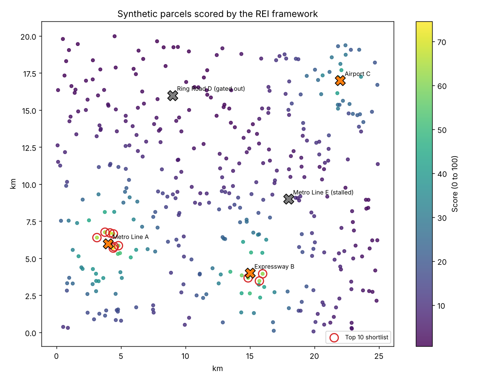

# REI Platform (Real Estate Intelligence)

A data platform I am building to find mispriced land in Indian cities, aimed at APAC investors looking at India real estate.

This repo is a **public showcase**. It explains the problem, the approach and the scoring logic, and includes a demo notebook on synthetic data. The production data pipeline, calibrated weights and validation set are kept private. Full code is available on request.

## The problem

Two things make Indian real estate hard to price from outside:

1. **Declared prices are unreliable.** Registered transaction values often sit below what actually changes hands, so official price data understates the market and hides where value really is.
2. **Infrastructure moves land prices, but most announcements never get built.** A new metro line or expressway can re-rate nearby land, yet many announced projects stall for years. Buying on the announcement alone is how investors lose money.

Most of the signals needed to tell the difference are public, but they are spread across many government portals and formats.

## The approach

REI pulls public infrastructure and property data into one place and scores land on two signals.

**1. Price gap signal**
Models the gap between declared and actual transaction prices to estimate where land is priced below its true market level.

**2. Infrastructure catalyst score (v2)**
Ranks parcels near upcoming projects on four factors:

| Factor | Question it answers |
|---|---|
| Credibility | Will this project actually get built? (sponsor, funding sanction, clearances, land acquisition) |
| Timing | How early are we? The most upside sits between approval and construction start |
| Proximity | How strongly does the project reach this parcel? (distance decay) |
| Headroom | Is the parcel still priced below comparable land nearby? |

Projects that fail a credibility gate are removed before any parcel is matched to them, so the model cannot borrow upside from an announcement that is unlikely to happen.

The output is not a dashboard of thousands of pins. It is a short list of high-conviction parcels.

## Demo

[`scoring_demo.ipynb`](scoring_demo.ipynb) runs the catalyst scoring end to end on 400 synthetic parcels and 5 synthetic projects. All data and weights in it are made up for illustration.



The notebook ends with a sanity check: parcels next to a stalled metro project score a median of 9 out of 100, against 64 for the top 10 shortlist, even though some of them look cheap. Filtering out that kind of trap is the point of the model.

## Validation

The scoring is backtested against 5 historical Indian infrastructure projects, and checked against projects that stalled or failed, to make sure the credibility filter actually removes them.

## Data sources (production)

All public:

- Central and state infrastructure authorities (for example NHAI and metropolitan development authorities)
- Environmental clearance records (PARIVESH)
- State RERA project registrations
- Housing price indices (NHB RESIDEX)

## Architecture (production)

```
Public portals  ->  Scrapers (Playwright)  ->  Cleaning and geocoding
                                                     |
                                                     v
                                       PostgreSQL + PostGIS (spatial joins)
                                                     |
                                                     v
                         Credibility, timing, proximity, headroom scoring
                                                     |
                                                     v
                                 Ranked shortlist of high-conviction parcels
```

## Status

In development. Current work: the v2 scoring model and validation against stalled projects.

---

Built by Trishnoorpreet Singh. Questions or access to the full code: trishnoor22@gmail.com
